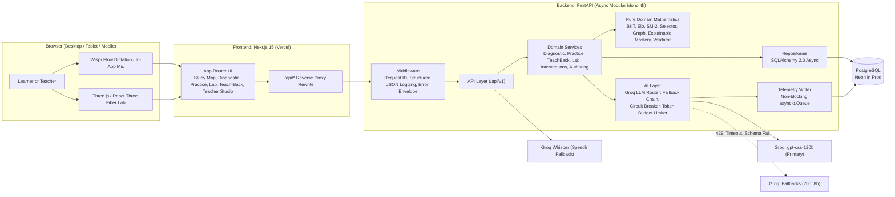
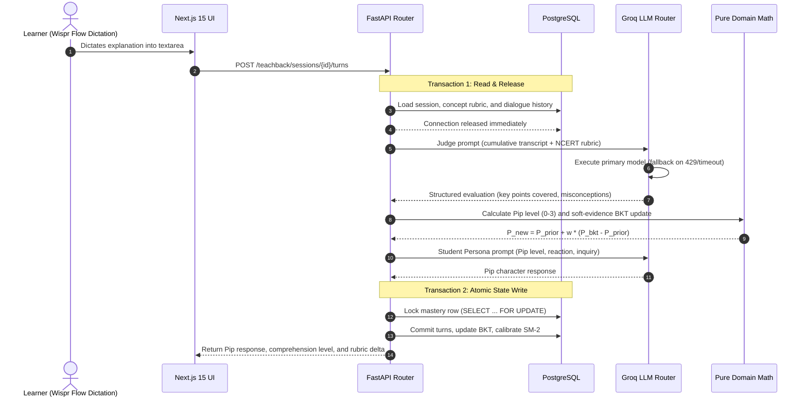

# 💬 Dialecto: The AI Tutor That Learns What You Know

> An adaptive **CBSE Class 10 Biology** tutor built with a real learner model. It tracks Bayesian knowledge states per concept, uncovers misconceptions from student *reasoning* (not just final answers), schedules spaced repetition, empowers teachers with automated intervention clinics and a $30 \times 20$ class heatmap, lets learners inspect interactive **3D cellular specimens**, and lets them prove mastery by **teaching a deliberately naive AI student called Pip**.

Built for the Agentic AI Hackathon (Product Space × Wispr Flow).

[](docs/testing.md)
[](docs/testing.md)
[](docs/design.md)
[](backend)
[](frontend)
[](backend/app/ai)
[](frontend/src/components/lab)

---

## 🚀 Live Deployments

- **Live Backend API (Render):** [`https://dialecto-backend-55qp.onrender.com`](https://dialecto-backend-55qp.onrender.com) (Health, OpenAPI docs at `/docs`)
- **Frontend App (Vercel):** Connected via reverse-proxy rewrites (`/api/*` → backend) with demo identity role switcher (`Aarav` Class 10 Student / `Ms. Rao` Biology Instructor).

---

## 💡 Why Dialecto

Generic AI tutors act as chatbots: they answer questions in isolation but maintain no persistent cognitive state. When a learner makes a mistake, chatbots give the answer away without diagnosing *why* or tracking whether the concept was truly acquired.

Dialecto maintains an authoritative, mathematical **learner model**:
1. **Bayesian Knowledge Tracing (BKT)** computes dynamic mastery probability $P(L)$ per curriculum concept.
2. **Item Response Theory / Elo Calibration** dynamically rates question difficulty from student responses.
3. **SM-2 Spaced Repetition** models memory retention and schedules reviews before concepts decay.
4. **Explainable Mastery & Confidence** separates raw mastery from evidence volume and evaluation diversity.
5. **Teach-Back Arena** challenges students to explain biology concepts to **Pip**, a naive peer AI learner.
6. **Interactive 3D Diagram Lab** brings cellular biology to life with authentic 3D specimens and direct organelle teaching.
7. **Teacher Intervention Planner** turns classroom analytics into targeted, one-click remedial clinics.

---

## ✨ Features

| Capability | What Dialecto Delivers |
|---|---|
| **Adaptive Diagnostic Exam** | 15-question adaptive assessment using uncertainty sampling ($P(L) \approx 0.5$) and topological prerequisite progression to establish an instant baseline. |
| **Interactive Study Map** | Interactive curriculum graph with 20 concepts across 3 NCERT chapters, featuring custom diagonal cubic Bézier edges, topological prerequisite locking, and live status badges (`ready`, `learning`, `mastered`, `locked`). |
| **Pure Learner Model** | Bayesian Knowledge Tracing with dynamic slip adjustment ($S_q = S + 0.05(d-2)$), continuous soft-evidence updates, and zero mathematical delegation to LLMs. |
| **Item Calibration (Elo)** | Real-time question difficulty calibration ($b \leftarrow b + K(\text{expected} - y)$) based on student ability proxy $\theta = \text{logit}(P(L))$. |
| **Misconception Detection** | Dual-channel classification: tagged distractor choices plus Groq LLM reasoning analysis comparing written/spoken explanations against 23 NCERT misconceptions. |
| **Spaced Repetition & Decay** | SuperMemo SM-2 repetition queue with quality ratings ($q \in \{1, 3, 4, 5\}$) and exponential mastery decay ($p_{\text{eff}} = p \cdot \exp(-\text{days\_overdue}/14)$). |
| **Teach-Back Mode with Pip** | Explain concepts out loud or in writing to Pip, a naive peer AI. A multi-rubric judge evaluates key points and misconceptions, updating BKT mastery via soft evidence while Pip advances through comprehension levels (Level 0: Confused $\rightarrow$ Level 3: Mastered). |
| **Interactive 3D Biology Lab** | 7 whitelisted cellular specimens from Cell Architecture Studio and NIH 3D Print Exchange with precision 3D model-local raycasting, anatomical pins, cross-section views, accessible 2D SVG atlas, and contextual "Teach this to Pip" directly from 3D structures. |
| **Explainable Mastery & Confidence** | Mathematical Evidence Confidence score $S \in [0.0, 1.0]$ based on sample size, difficulty variance, decay, and mode diversity (Practice, Diagnostic, Teach-Back, Lab), with deterministic state narratives and chronological evidence timelines. |
| **Teacher Intervention Planner** | Automated triage identifying struggling cohorts ($\ge 35\%$ failure rate, $<0.50$ mastery, or shared active misconceptions), 1-click targeted clinic assignments with voice notes, live student progress, and before/after outcome gain measurement. |
| **Teacher Classroom Heatmap** | $30 \times 20$ interactive student-by-concept knowledge matrix, failure-ranked curriculum gaps, class misconception hotspots, and at-risk student drill-down drawers. |
| **AI Question Authoring Studio** | Curriculum-grounded question generator with pure pedagogical validation, multi-stage approval workflow (`draft`, `approved`, `rejected`), protecting the question bank from unreviewed drafts. |
| **Voice-First Dictation** | Tailored for Wispr Flow system-wide dictation into native `<textarea>` elements, with Groq Whisper audio transcription as an in-app microphone fallback. |
| **Observability Panel (`/ops`)** | Live operational telemetry dashboard reporting P50/P95 LLM latencies, circuit breaker states, continuous token budget refill rates, and execution audit logs. |

---

## 🔬 Interactive 3D Biology Lab & Whitelisted Specimens

Dialecto enforces strict biological fidelity. All 3D diagram models are sourced directly from verified educational repositories: [Cell Architecture Studio](https://github.com/cclank/cell-architecture-studio) and the National Institutes of Health (NIH 3D Print Exchange). Unverified or placeholder diagrams are strictly prohibited.

| Specimen ID | Specimen Name | Visual Architecture | Curriculum Concept | Provenance / License |
|---|---|---|---|---|
| `plant` | **Plant Cell** | Production GLB (`/models/plant-cell-first001.glb`) | Photosynthesis (`lp-photosynthesis`) | Cell Architecture Studio / CC-BY-4.0 |
| `whiteBlood` | **White Blood Cell** | Production GLB (`/models/white-blood-cell-user.glb`) | Circulation & Defense (`lp-circulation`) | Cell Architecture Studio / CC-BY-4.0 |
| `animal` | **Animal Cell** | Production GLB (`/models/animal-cell-nih.glb`) | Respiration (`lp-respiration`) | NIH 3DPX-015797 / Public Domain CC0 |
| `neuron` | **Neuron** | Production GLB (`/models/neuron-nih.glb`) | Nerve Transmission (`cc-neuron`) | NIH 3DPX-015796 / Public Domain CC0 |
| `bacteria` | **Bacterial Cell Wall** | Production GLB (`/models/bacteria-wall-nih.glb`) | Nutrition (`lp-nutrition`) | NIH 3DPX-010752 / Public Domain CC0 |
| `epithelial` | **Epithelial Cell** | Procedural 3D Brush Border (`EpithelialModel`) | Digestion (`lp-digestion`) | Cell Architecture Studio / MIT |
| `muscle` | **Muscle Cell** | Procedural Sarcomere Bundles (`MuscleModel`) | Respiration (`lp-respiration`) | Cell Architecture Studio / MIT |

*For complete provenance, mesh attributes, and citations, see [`docs/ASSETS_ATTRIBUTION.md`](docs/ASSETS_ATTRIBUTION.md).*

---

## 🏛️ System Architecture

Dialecto is built as a resilient **modular monolith** adhering to strict dependency layering: `api` $\rightarrow$ `services` $\rightarrow$ `repositories`, `domain`, and `ai`. Routers contain zero business logic; `domain/` contains zero I/O; and **database transactions are never held open across LLM calls**.



### Teach-Back Turn Lifecycle



---

## 📐 Mathematical Formulation

### 1. Bayesian Knowledge Tracing (BKT)
- **Observation update:**
  $$\begin{aligned}
  P(L \mid \text{correct}) &= \frac{P(L)(1 - S_q)}{P(L)(1 - S_q) + (1 - P(L)) G} \\
  P(L \mid \text{wrong}) &= \frac{P(L) S_q}{P(L) S_q + (1 - P(L))(1 - G)}
  \end{aligned}$$
- **Dynamic slip adjustment:** $S_q = \text{clamp}(S + 0.05(d - 2), 0.02, 0.30)$ for difficulty bucket $d \in \{1, 2, 3\}$.
- **Transition update:**
  $$P(L') = P(L \mid \text{obs}) + (1 - P(L \mid \text{obs})) T$$
- **Soft evidence (Teach-Back & Lab):**
  $$P_{\text{new}} = P_{\text{prior}} + w \cdot (P_{\text{bkt}} - P_{\text{prior}}), \quad w = \min(0.70, \text{confidence})$$

### 2. Item Difficulty Calibration (Elo)
- Student latent ability proxy: $\theta = \text{logit}(P(L))$.
- Expected success probability: $\sigma(\theta - b) = \frac{1}{1 + e^{-(\theta - b)}}$.
- Calibration update (active after $n \ge 5$ attempts):
  $$b \leftarrow b + K \cdot (\sigma(\theta - b) - y), \quad K = 0.10, \; y \in \{0, 1\}$$

### 3. Spaced Repetition (SM-2) & Exponential Decay
- Interval and ease factor update based on quality rating $q \in \{1, 3, 4, 5\}$.
- Effective mastery decay when reviews are overdue ($\Delta t > 0$):
  $$p_{\text{eff}} = p \cdot \exp\left(-\frac{\Delta t}{14}\right)$$

### 4. Explainable Mastery & Evidence Confidence
- Evidence confidence score $S \in [0.0, 1.0]$:
  $$S = \text{clamp}\left(0.40 \cdot \min\left(1.0, \frac{n}{6}\right) + 0.20 \cdot \min\left(1.0, \frac{m}{3}\right) + 0.25 \cdot e^{-\Delta t / 30} + 0.15 \cdot (1 - \text{var}_d), 0.0, 1.0\right)$$
  *(where $n$ is sample count, $m$ is distinct modality count, $\Delta t$ is days since last attempt, and $\text{var}_d$ is question difficulty variance).*

---

## 📂 Repository Structure

```text
dialecto/
├── AGENTS.md                                # Standing protocol & operational rules
├── README.md                                # Authoritative overview & system documentation
├── Makefile                                 # Build, quality checks, test, and seed tasks
├── docker-compose.yml                       # PostgreSQL local container
├── .env.example                             # Environment template
├── docs/
│   ├── architecture.md                      # Layering, modular monolith constraints, concurrency
│   ├── ASSETS_ATTRIBUTION.md                # 3D specimen provenance & licensing records
│   ├── prd.md / features.md                 # Product requirements and feature catalog
│   ├── design.md                            # Taste Skill design tokens & typography
│   ├── curriculum.md                        # CBSE Class 10 NCERT concepts & misconceptions
│   ├── progress.md                          # Permanent handoff memory across agent sessions
│   └── DECISIONS.md                         # Architecture Decision Records (ADRs)
├── backend/
│   ├── pyproject.toml / uv.lock             # Python 3.12 dependencies managed via uv
│   ├── Dockerfile                           # Production multi-stage Docker build
│   ├── alembic.ini / migrations/            # Async database schema migrations
│   ├── app/
│   │   ├── main.py                          # Lifespan, CORS, rate limits, telemetry queue
│   │   ├── core/                            # Config, logging, AppError hierarchy, middleware
│   │   ├── api/v1/endpoints/
│   │   │   ├── authoring.py                 # Teacher question generation & review endpoints
│   │   │   ├── concepts.py                  # Concept graph & DAG details
│   │   │   ├── diagnostic.py                # 15-question adaptive assessment
│   │   │   ├── diagrams.py                  # 3D diagram manifests & assessment submissions
│   │   │   ├── learner.py                   # Student mastery & explainable narratives
│   │   │   ├── ops.py                       # Operational telemetry & circuit breaker stats
│   │   │   ├── practice.py                  # Adaptive practice & distractor submissions
│   │   │   ├── review.py                    # Spaced review queues
│   │   │   ├── speech.py                    # Groq Whisper transcription fallback
│   │   │   ├── teachback.py                 # Teach-Back session creation & turns
│   │   │   ├── teacher.py                   # Heatmap, gaps, at-risk, and clinic endpoints
│   │   │   └── users.py                     # Demo identity provider
│   │   ├── services/                        # Business orchestration & transaction boundaries
│   │   │   ├── concept_service.py
│   │   │   ├── diagnostic_service.py
│   │   │   ├── diagram_assessment_service.py
│   │   │   ├── diagram_command_service.py
│   │   │   ├── explainable_mastery_service.py
│   │   │   ├── intervention_service.py
│   │   │   ├── learner_service.py
│   │   │   ├── practice_service.py
│   │   │   ├── question_authoring_service.py
│   │   │   ├── review_service.py
│   │   │   ├── teachback_service.py
│   │   │   └── teacher_service.py
│   │   ├── domain/                          # PURE Python learner math (no I/O, 100% unit tested)
│   │   │   ├── bkt.py                       # Bayesian Knowledge Tracing
│   │   │   ├── elo.py                       # Elo difficulty rating calibration
│   │   │   ├── explainable_mastery.py       # Evidence confidence & state narratives
│   │   │   ├── graph.py                     # Topological DAG validation & prerequisite locking
│   │   │   ├── question_validator.py        # Pedagogical question integrity rules
│   │   │   ├── selector.py                  # Active next-question selection policy
│   │   │   └── sm2.py                       # SuperMemo SM-2 & decay calculation
│   │   ├── ai/
│   │   │   ├── llm/                         # Groq client, router, breaker, budget, recorder
│   │   │   ├── agents/                      # Judge, Student Persona, Misconception Classifier
│   │   │   └── prompts/                     # Markdown prompt templates with typed placeholders
│   │   ├── models/                          # SQLAlchemy 2.0 async ORM entities
│   │   ├── repositories/                    # Isolated database access layer
│   │   └── content/                         # concepts.json, misconceptions.json, questions.json
│   └── tests/
│       ├── unit/                            # Pure domain mathematics tests
│       └── integration/                     # Endpoint & concurrency tests (PostgreSQL + mocked Groq)
└── frontend/
    ├── package.json / pnpm-lock.yaml        # Next.js 15, React 19, TypeScript dependencies
    ├── next.config.ts                       # Reverse-proxy rewrite to backend
    ├── public/models/                       # Authenticated 3D GLB specimens (NIH 3DPX / CAS)
    └── src/
        ├── app/
        │   ├── (student)/
        │   │   ├── dashboard/               # Interactive Study Map & active alerts
        │   │   ├── diagnostic/              # Adaptive 15-question baseline exam
        │   │   ├── practice/                # Adaptive practice with voice-friendly textarea
        │   │   ├── lab/                     # Interactive 3D Biology Lab & contextual Teach-Back
        │   │   ├── teach-back/[conceptId]/  # Dedicated Teach-Back Arena with Pip
        │   │   └── review/                  # Spaced Repetition queue
        │   ├── (teacher)/
        │   │   ├── class/                   # Classroom Heatmap, Gaps, and Intervention Planner
        │   │   └── authoring/               # AI Question Studio & Review Pipeline
        │   └── ops/                         # AI System Health & Telemetry Dashboard
        └── components/
            ├── graph/                       # React Flow DAG with custom curved Bézier edges
            ├── lab/                         # Three.js 3D Viewer, 2D SVG Atlas, Pip Slide-Over
            ├── teacher/                     # Heatmap matrix, Clinic Drawer, Outcome Measurement
            └── ui/                          # Dictation-friendly textarea, modals, badges, cards
```

---

## 🛠️ Tech Stack

| Layer | Component | Technology Choice |
|---|---|---|
| **Backend** | API Framework | Python 3.12, FastAPI, AsyncIO, Pydantic v2, `pydantic-settings` |
| **Database** | ORM & Migrations | PostgreSQL, SQLAlchemy 2.0 Async (`asyncpg`), Alembic |
| **Packaging** | Package Manager | **uv** (Backend: strict lockfile), **pnpm** (Frontend) |
| **AI Layer** | Inference & Routing | Groq Async SDK (`openai/gpt-oss-120b` primary with `llama-3.3-70b` & `llama-3.1-8b` fallbacks) |
| **Speech** | Transcription | Wispr Flow native dictation, Groq Whisper API (`whisper-large-v3`) fallback |
| **3D Graphics** | WebGL / 3D Canvas | Three.js, React Three Fiber (`@react-three/fiber`), `@react-three/drei` |
| **Frontend** | Application Framework | Next.js 15 (App Router), TypeScript Strict, Tailwind CSS, shadcn/ui |
| **Visualization**| Graphs & Charts | `@xyflow/react` (React Flow for Concept DAG), Recharts |
| **Testing** | Verification Suites | `pytest`, `pytest-asyncio`, `respx` (Mocked Groq), `ruff`, `mypy`, ESLint |

---

## 🏁 Quickstart

### Prerequisites
- Python 3.12+ and [`uv`](https://docs.astral.sh/uv/)
- Node.js 20+ and [`pnpm`](https://pnpm.io/)
- Docker & Docker Compose
- Groq API Key

### 1. Clone & Configure
```bash
git clone https://github.com/your-org/dialecto.git
cd dialecto

# Create environment file
cp .env.example .env
# Edit .env and insert your GROQ_API_KEY
```

### 2. Start PostgreSQL
```bash
docker compose up -d db
```

### 3. Backend Setup & Database Seeding
```bash
cd backend

# Sync dependencies with uv
uv sync

# Run database migrations
uv run alembic upgrade head

# Seed verified curriculum and 30 simulated students via pure domain math
uv run python -m app.db.seed

# Start FastAPI development server
uv run uvicorn app.main:app --reload --port 8000
```

### 4. Frontend Setup
```bash
cd ../frontend

# Install dependencies
pnpm install

# Generate typed TypeScript client from backend OpenAPI specification
pnpm gen:api

# Start Next.js development server
pnpm dev
```

## Environment variables

| Variable | Purpose |
|---|---|
| `DATABASE_URL` | `postgresql+asyncpg://...` (Neon: use `ssl=require`) |
| `GROQ_API_KEY` | Groq API key |
| `LLM_PRIMARY_MODEL` | default `openai/gpt-oss-120b` |
| `LLM_FALLBACK_MODELS` | comma-separated, ordered; verified against Groq's models list at startup |
| `WHISPER_MODEL` | Groq speech model for the mic fallback |
| `LLM_TIMEOUT_S` | per-call timeout |
| `CORS_ORIGINS` | allowed origins |
| `BACKEND_URL` | used by the Next.js rewrite |
| `LOG_LEVEL`, `ENV` | logging and environment |

## Wispr Flow

Wispr Flow has no public API, so Dialecto does not integrate it in code. It is a **first-class input method**: every free-text field is a plain, large, autofocused textarea that works perfectly with Wispr Flow's system-wide dictation. Learners press their Wispr Flow hotkey and *explain out loud*, which gives the Teach-Back judge long, natural reasoning. Users without Wispr Flow get an in-app mic button powered by Groq Whisper.

## Testing

`make check` runs lint, types, and tests for both apps. Integration tests use a real Postgres and a mocked Groq. `make eval` runs the judge against a golden set of explanations (live API, opt-in).

## Roadmap

Real authentication; Redis-backed shared rate limits and a task queue for multi-instance deployment; more subjects; teacher-authored question banks; streaming Teach-Back replies.


