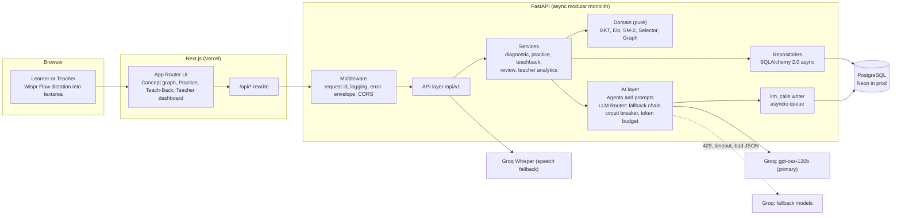
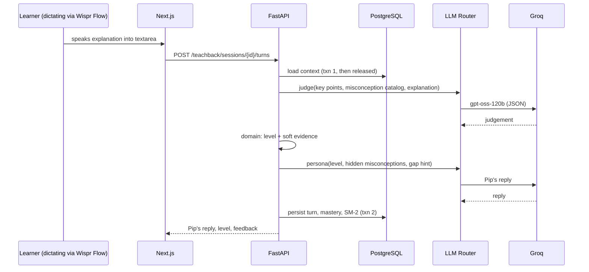
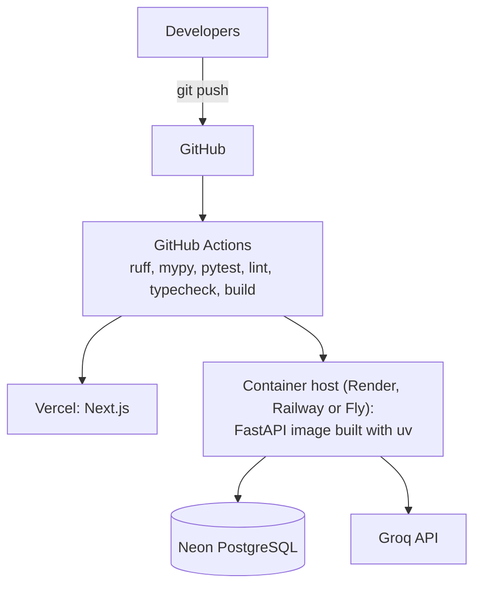

# 💬 Dialecto: the AI tutor that learns what you know

> An adaptive **CBSE Class 10 Biology** tutor with a real learner model. It tracks a Bayesian mastery estimate for every concept, detects misconceptions from your *reasoning* (not just your final answer), schedules spaced repetition, gives teachers a class-wide gap map, and lets you prove mastery by **teaching a deliberately naive AI student called Pip**.

Built for the Agentic AI Hackathon (Product Space × Wispr Flow).

<!-- Add demo GIF here: docs/assets/demo.gif -->

## Why Dialecto

Generic AI tutors answer questions but never track what you actually understand. Dialecto keeps a **learner model**: a probability of mastery per concept, updated after every answer, that drives what you practise next, when you review, and what your teacher sees.

## Features

| Brief requirement | How Dialecto does it |
|---|---|
| Diagnostic test | 15-question adaptive diagnostic using uncertainty sampling and prerequisite inference |
| Concept graph | 20 concepts across 3 chapters with prerequisites; nodes recolor live as mastery changes |
| Learner model | Bayesian Knowledge Tracing per concept, updated after every answer |
| Targeted questions + difficulty calibration | Selector targets weak, unlocked concepts at about 70% predicted success; item difficulty is calibrated with an Elo-style update |
| Misconception detection | Tagged distractors plus an LLM classifier over the student's written or spoken reasoning |
| Spaced repetition | SM-2 scheduling with mastery decay |
| Teacher dashboard | Class heatmap, weakest concepts, top misconceptions, at-risk students |
| **Teach-Back (our differentiator)** | Explain a concept to Pip, a naive student AI; a judge scores your explanation against a rubric and feeds the learner model |
| **Voice-first input** | Built for Wispr Flow dictation; Groq Whisper mic button as fallback |

## Architecture



### Teach-Back turn (the interesting flow)



### Delivery topology



Design principles: a **modular monolith** with a strict dependency rule; **pure domain logic** (all learner math is unit-tested and never delegated to an LLM); **graceful degradation** (if every LLM is down, diagnostic and practice keep working); **observability built in** (structured logs plus an `llm_calls` table surfaced in an AI reliability panel). Details in [`docs/architecture.md`](docs/architecture.md).

## Repository structure

```text
dialecto/
├── AGENTS.md                      # standing rules for AI agents
├── MASTER_PROMPT.md               # bootstrap prompt (not shipped to prod)
├── README.md
├── Makefile                       # dev, check, test, seed, migrate, eval
├── docker-compose.yml             # postgres, backend, frontend
├── .env.example
├── .github/
│   └── workflows/ci.yml
├── docs/
│   ├── prd.md
│   ├── design.md                  # design language (Taste Skill), approved before UI work
│   ├── architecture.md
│   ├── database.md
│   ├── api.md
│   ├── agents.md
│   ├── curriculum.md
│   ├── features.md
│   ├── plan.md
│   ├── testing.md
│   ├── setup.md
│   ├── progress.md                # agent handoff memory
│   ├── DECISIONS.md               # decision log
│   └── assets/
├── backend/
│   ├── pyproject.toml
│   ├── uv.lock
│   ├── Dockerfile                 # multi-stage, uv, non-root
│   ├── alembic.ini
│   ├── migrations/
│   │   ├── env.py
│   │   └── versions/
│   ├── app/
│   │   ├── main.py                # app factory, lifespan (db, llm router, log writer)
│   │   ├── core/
│   │   │   ├── config.py          # pydantic-settings
│   │   │   ├── logging.py         # structlog setup
│   │   │   ├── errors.py          # AppError hierarchy and handlers
│   │   │   ├── middleware.py      # request id, access log
│   │   │   └── limits.py          # per-user in-process rate limit
│   │   ├── api/
│   │   │   ├── deps.py            # db session, current demo user
│   │   │   └── v1/
│   │   │       ├── router.py
│   │   │       └── endpoints/
│   │   │           ├── health.py
│   │   │           ├── users.py
│   │   │           ├── concepts.py
│   │   │           ├── learner.py
│   │   │           ├── diagnostic.py
│   │   │           ├── practice.py
│   │   │           ├── teachback.py
│   │   │           ├── reviews.py
│   │   │           ├── teacher.py
│   │   │           ├── speech.py
│   │   │           └── ops.py
│   │   ├── schemas/               # Pydantic request/response models
│   │   ├── models/                # SQLAlchemy ORM models
│   │   ├── db/
│   │   │   ├── base.py
│   │   │   ├── session.py         # async engine and sessionmaker
│   │   │   └── seed.py            # idempotent content and class simulation
│   │   ├── repositories/          # data access only
│   │   ├── services/              # use cases (orchestration, transactions)
│   │   │   ├── diagnostic.py
│   │   │   ├── practice.py
│   │   │   ├── teachback.py
│   │   │   ├── review.py
│   │   │   ├── teacher_analytics.py
│   │   │   └── misconceptions.py
│   │   ├── domain/                # PURE logic, no I/O
│   │   │   ├── bkt.py
│   │   │   ├── elo.py
│   │   │   ├── sm2.py
│   │   │   ├── selector.py
│   │   │   └── graph.py
│   │   ├── ai/
│   │   │   ├── llm/
│   │   │   │   ├── client.py      # Groq async wrapper
│   │   │   │   ├── router.py      # fallback chain, repair retry
│   │   │   │   ├── breaker.py     # circuit breaker
│   │   │   │   ├── budget.py      # token budget per model
│   │   │   │   └── recorder.py    # llm_calls queue writer
│   │   │   ├── agents/
│   │   │   │   ├── student_persona.py
│   │   │   │   ├── judge.py
│   │   │   │   ├── misconception_classifier.py
│   │   │   │   └── lesson.py
│   │   │   ├── prompts/           # *.md templates
│   │   │   └── speech.py          # Groq Whisper
│   │   └── content/               # concepts.json, misconceptions.json, questions.json
│   ├── scripts/
│   │   └── generate_questions.py
│   └── tests/
│       ├── unit/                  # domain
│       ├── integration/           # endpoints with real Postgres, mocked Groq
│       └── evals/                 # judge golden set (live, opt-in)
└── frontend/
    ├── package.json
    ├── next.config.ts             # rewrites /api/* to the backend
    ├── Dockerfile
    └── src/
        ├── app/
        │   ├── layout.tsx
        │   ├── page.tsx           # role switcher (demo identity)
        │   ├── (student)/
        │   │   ├── dashboard/
        │   │   ├── diagnostic/
        │   │   ├── practice/
        │   │   ├── teach-back/[conceptId]/
        │   │   └── review/
        │   ├── (teacher)/
        │   │   └── class/
        │   └── ops/               # AI reliability panel
        ├── components/
        │   ├── ui/                # shadcn/ui
        │   ├── graph/             # concept graph (React Flow)
        │   ├── practice/
        │   ├── teachback/         # dictation-friendly textarea, Pip chat
        │   └── teacher/           # heatmap, gap list
        ├── lib/
        │   ├── api/               # generated types and typed client
        │   └── utils.ts
        └── hooks/
```

## Tech stack

| Layer | Technology |
|---|---|
| Backend | Python 3.12, FastAPI, asyncio, Pydantic v2 |
| Data | PostgreSQL, SQLAlchemy 2.0 (async, asyncpg), Alembic |
| Packaging | uv |
| AI | Groq (`openai/gpt-oss-120b` primary, fallback chain in config), Groq Whisper |
| Frontend | Next.js (App Router), TypeScript, Tailwind, shadcn/ui, TanStack Query, React Flow, Recharts, Motion; UI built with the Taste Skill |
| Quality | ruff, mypy, pytest, respx, ESLint, GitHub Actions, Docker |

## How mastery works

- **BKT update** with prior `P(L)`, slip `S`, guess `G`, learn rate `T`:
  - correct: `P(L|c) = P(L)(1-S) / [P(L)(1-S) + (1-P(L))G]`
  - wrong: `P(L|w) = P(L)S / [P(L)S + (1-P(L))(1-G)]`
  - then `P(L') = P(L|obs) + (1 - P(L|obs)) T`
- **Soft evidence** (Teach-Back): `P_new = P_prior + w·(P_bkt − P_prior)` where `w` is capped by the judge's confidence.
- **Difficulty calibration:** `θ = logit(P(L))`; expected success `σ(θ − b)`; item difficulty `b ← b + K(σ(θ − b) − y)`.
- **Spaced repetition:** SM-2 per concept; effective mastery decays when a review is overdue.

Full rules in [`docs/architecture.md`](docs/architecture.md) and [`docs/agents.md`](docs/agents.md).

## Quickstart

```bash
cp .env.example .env                 # set GROQ_API_KEY
docker compose up -d db

cd backend
uv sync
uv run alembic upgrade head
uv run python -m app.db.seed
uv run uvicorn app.main:app --reload --port 8000

cd ../frontend
pnpm install
pnpm gen:api                         # generate API types from the backend OpenAPI
pnpm dev
```

## Environment variables

| Variable | Purpose |
|---|---|
| `DATABASE_URL` | `postgresql+asyncpg://...` (Neon: use `ssl=require`) |
| `GROQ_API_KEY` | Groq API key |
| `LLM_PRIMARY_MODEL` | default `openai/gpt-oss-120b` |
| `LLM_FALLBACK_MODELS` | comma-separated, ordered; verified against Groq's models list at startup |
| `WHISPER_MODEL` | Groq speech model for the mic fallback |
| `LLM_TIMEOUT_S` | per-call timeout |
| `CORS_ORIGINS` | allowed origins |
| `BACKEND_URL` | used by the Next.js rewrite |
| `LOG_LEVEL`, `ENV` | logging and environment |

## Wispr Flow

Wispr Flow has no public API, so Dialecto does not integrate it in code. It is a **first-class input method**: every free-text field is a plain, large, autofocused textarea that works perfectly with Wispr Flow's system-wide dictation. Learners press their Wispr Flow hotkey and *explain out loud*, which gives the Teach-Back judge long, natural reasoning. Users without Wispr Flow get an in-app mic button powered by Groq Whisper.

## Testing

`make check` runs lint, types, and tests for both apps. Integration tests use a real Postgres and a mocked Groq. `make eval` runs the judge against a golden set of explanations (live API, opt-in).

## Roadmap

Real authentication; Redis-backed shared rate limits and a task queue for multi-instance deployment; more subjects; teacher-authored question banks; streaming Teach-Back replies.


