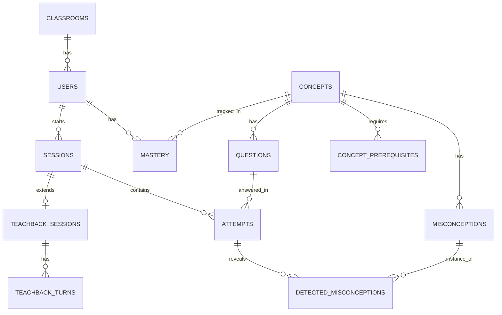

# Database

PostgreSQL, SQLAlchemy 2.0 async (asyncpg), Alembic migrations. All timestamps are `timestamptz` (UTC). Content tables use stable slug primary keys so JSON content files can reference them; runtime tables use `bigint` identity keys.

## ERD

## Tables

### Content (seeded from `app/content/*.json`, idempotent upsert)

**`concepts`**

| Column | Type | Notes |
|---|---|---|
| `id` | text PK | slug, e.g. `lp-photosynthesis` |
| `chapter` | text | `life-processes` \| `control-coordination` \| `heredity` |
| `name` | text | |
| `description` | text | one-paragraph summary |
| `lesson_md` | text | pre-generated, reviewed lesson |
| `key_points` | jsonb | `string[]`, the judge's rubric (never returned to students) |
| `p_l0`, `p_t`, `p_s` | float | BKT params; CHECK between 0 and 1 |
| `position` | int | display order |

**`concept_prerequisites`**: `concept_id` FK, `prerequisite_id` FK; PK both; CHECK `concept_id <> prerequisite_id`. The service layer validates acyclicity at seed time.

**`misconceptions`**: `id` text PK (e.g. `m-o2-from-co2`), `concept_id` FK, `statement`, `correction`.

**`questions`**

| Column | Type | Notes |
|---|---|---|
| `id` | text PK | |
| `concept_id` | FK | |
| `kind` | enum `mcq` | (short-answer reserved) |
| `stem` | text | |
| `options` | jsonb | `[{"key":"A","text":"...","misconception_id":"m-..."\|null}]` |
| `correct_key` | text | |
| `explanation` | text | |
| `difficulty_bucket` | smallint | 1, 2, 3 |
| `difficulty_rating` | float | Elo-calibrated `b`; seeded -1.0 / 0.0 / 1.0 |
| `n_attempts` | int | for the 5-attempt calibration gate |
| `verified` | bool | only `true` rows are served |
| `source` | enum | `seed` \| `llm` |

### Identity (no auth, demo identities only)

**`classrooms`**: `id` bigint PK, `name`.
**`users`**: `id` bigint PK, `display_name`, `role` enum (`student`, `teacher`), `classroom_id` FK, `is_simulated` bool.

### Learner state

**`mastery`**: PK `(user_id, concept_id)`

| Column | Type | Notes |
|---|---|---|
| `p_mastery` | float | CHECK 0..1 |
| `attempts`, `correct` | int | |
| `last_seen_at` | timestamptz | |
| `ease` | float | SM-2 EF, default 2.5, min 1.3 |
| `interval_days` | int | |
| `repetitions` | int | |
| `next_due_at` | timestamptz | nullable until first attempt |
| `version` | int | optimistic counter (belt and braces with `FOR UPDATE`) |

**`sessions`**: `id` PK, `user_id` FK, `kind` enum (`diagnostic`, `practice`, `review`, `teachback`), `status` enum (`active`, `completed`, `abandoned`), `started_at`, `ended_at`.

**`attempts`**

| Column | Type | Notes |
|---|---|---|
| `id` | bigint PK | |
| `client_attempt_id` | uuid | **UNIQUE**, idempotency key |
| `session_id`, `user_id`, `question_id`, `concept_id` | FKs | |
| `selected_key` | text | |
| `is_correct` | bool | |
| `reasoning_text` | text | nullable; learner free text |
| `response_ms` | int | |
| `mastery_before`, `mastery_after` | float | for the animated mastery change and audit |
| `created_at` | timestamptz | |

**`detected_misconceptions`**: `id`, `user_id`, `misconception_id` FK, `attempt_id` FK nullable, `teachback_turn_id` FK nullable, `source` enum (`distractor`, `llm_reasoning`, `teachback`), `confidence` float, `created_at`, `resolved_at` nullable. A misconception is marked resolved when the learner answers a question tagged to it correctly twice in a row (service rule).

### Teach-Back

**`teachback_sessions`**: `id` PK, `session_id` FK, `user_id`, `concept_id`, `status` (`active`, `completed`, `abandoned`), `turn_count`, `final_score` float nullable, `final_level` smallint nullable.
**`teachback_turns`**: `id`, `teachback_session_id` FK, `idx` int, `role` enum (`pip`, `learner`), `content` text, `judge` jsonb nullable (the judge output for the learner turn), `level` smallint nullable (Pip's level after this turn), `created_at`. UNIQUE `(teachback_session_id, idx)`.

### Observability

**`llm_calls`**: `id`, `purpose` (`judge`, `persona`, `classifier`, `lesson`, `question_gen`), `model`, `attempt_no` int, `fallback_used` bool, `latency_ms`, `prompt_tokens`, `completion_tokens`, `status` (`ok`, `rate_limited`, `timeout`, `invalid_json`, `error`), `error_class` text nullable, `created_at`. Contains **no prompt or response bodies**.

## Indexes

- `attempts (user_id, created_at DESC)`, `attempts (concept_id)`, UNIQUE `attempts (client_attempt_id)`
- `mastery (concept_id)` and `mastery (user_id, next_due_at)`
- `questions (concept_id, verified, difficulty_rating)`
- `detected_misconceptions (misconception_id)` and `(user_id, resolved_at)`
- `teachback_turns (teachback_session_id, idx)`
- `llm_calls (created_at DESC)`, `(model, created_at)`

## Conventions

- ORM models use `Mapped[...]` and `mapped_column`. Enums are native Postgres enums created in migrations.
- Foreign keys use `ON DELETE CASCADE` only for owned children (`teachback_turns`, `detected_misconceptions`); otherwise `RESTRICT`.
- Migrations are autogenerated, then **reviewed by hand**; enum and check-constraint changes are often missed by autogenerate. Never edit a committed migration.
- Teacher aggregates are computed on read with SQL (`AVG`, `COUNT FILTER`) over `mastery`. At 30 students by 20 concepts this is trivial; the scale path is in `architecture.md`.

## Seeding (`python -m app.db.seed`)

1. Upsert `concepts`, `concept_prerequisites`, `misconceptions`, and verified `questions` from JSON. Validate that the prerequisite graph is a DAG; fail loudly if not.
2. Create one classroom, one teacher ("Ms. Rao"), a featured fresh student ("Aarav", no history, used for the live demo), and **30 simulated students** (`is_simulated = true`).
3. Simulate history for the 30 through the **real** services and domain functions (no LLM, no hand-written mastery numbers):
   - deterministic `random.Random(42)`;
   - each student has a latent ability and a per-concept true-knowledge flag with a few classroom-wide weak spots (so the heatmap tells a story);
   - answers are sampled from that truth; wrong answers pick tagged distractors, which seeds `detected_misconceptions`;
   - attempts are back-dated across the last 21 days so SM-2 due dates and decay look natural.
4. The seed is idempotent: re-running does not duplicate rows or reset the featured student's progress unless `--reset-demo` is passed.
